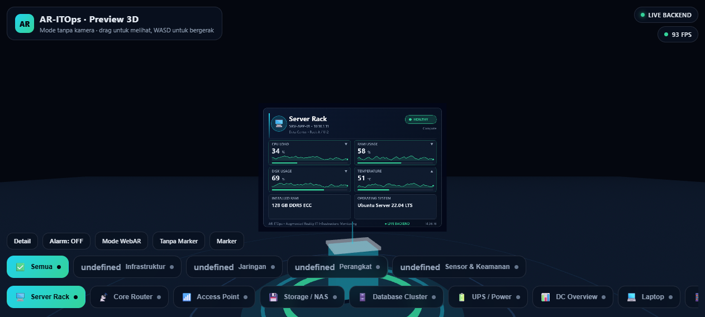
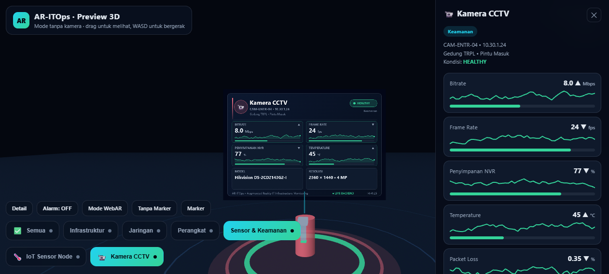
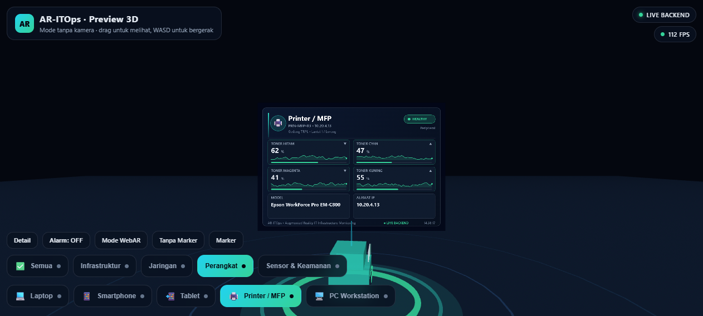
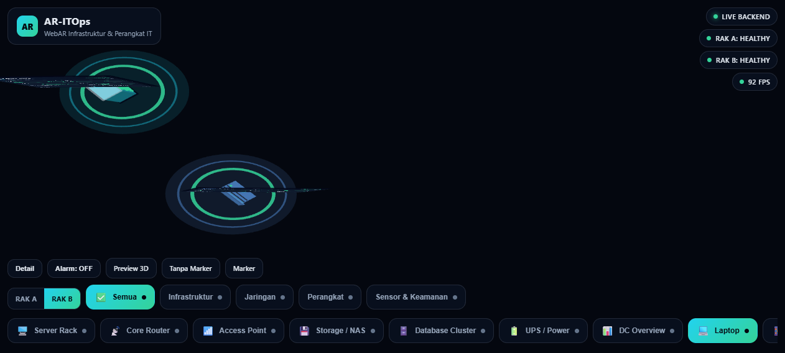
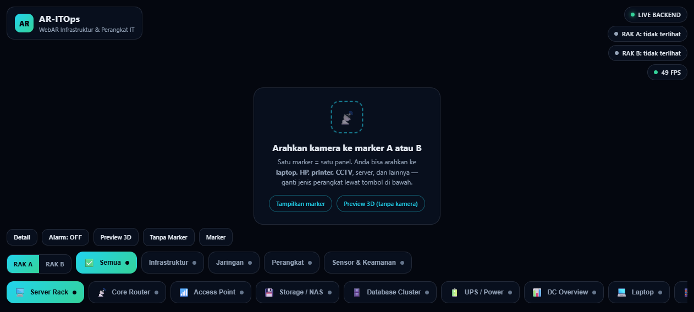
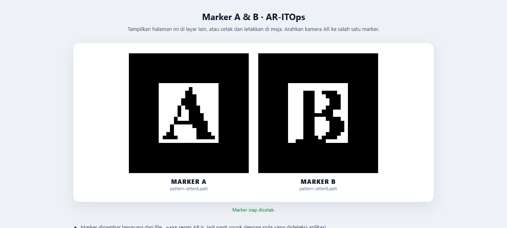

# AR-ITOps — WebAR Monitoring Infrastruktur & Perangkat IT

**Tugas 2 (sebelum UTS) — Prodi Teknologi Rekayasa Perangkat Lunak (TRPL)**

Augmented Reality berbasis web yang menampilkan **data monitoring aset IT secara real-time** di atas sebuah marker. Arahkan kamera ke marker, maka muncul "dashboard hologram" 3D berisi metrik perangkat — lengkap dengan grafik tren, indikator alert, dan alarm.

Bukan hanya server: aplikasi ini bisa dipakai untuk **melihat perangkat sehari-hari** — laptop, HP, tablet, printer, CCTV, access point — sekaligus infrastruktur data center.

## Modul (14 perangkat, ±180 metrik, 4 kategori)

**Infrastruktur**

| Modul | Ikon | Contoh data |
|---|---|---|
| Server Rack | 🖥️ | CPU, RAM, disk, suhu, network in/out, load, uptime, container |
| Storage / NAS | 💾 | kapasitas, IOPS, baca/tulis, RAID, SMART, snapshot, replikasi |
| Database Cluster | 🗄️ | query/detik, koneksi, replication lag, cache hit, slow query, TPS |
| UPS / Power | 🔋 | beban, baterai, runtime, tegangan, frekuensi, jadwal ganti baterai |
| DC Overview | 📊 | aset online, alert, perangkat offline, suhu ruang, total daya, SLA |

**Jaringan**

| Modul | Ikon | Contoh data |
|---|---|---|
| Core Router | 📡 | throughput, klien terhubung, latency, packet loss, port, VLAN, VPN |
| Access Point | 📶 | klien WiFi, channel utilization, band/channel, throughput, PoE |

**Perangkat (endpoint)**

| Modul | Ikon | Contoh data |
|---|---|---|
| Laptop | 💻 | CPU, RAM, disk, **baterai + kesehatan baterai + siklus**, MDM, BitLocker, garansi |
| Smartphone | 📱 | baterai, penyimpanan, sinyal, patch keamanan, MDM, IMEI (disamarkan) |
| Tablet | 📲 | baterai, penyimpanan, peminjam, MDM, sinkron terakhir |
| Printer / MFP | 🖨️ | **level toner K/C/M/Y**, antrean cetak, kertas, halaman total, servis |
| PC Workstation | 🖥️ | CPU, RAM, GPU, disk, suhu, antivirus, patch, proses |

**Sensor & Keamanan**

| Modul | Ikon | Contoh data |
|---|---|---|
| IoT Sensor Node | 🌡️ | suhu, kelembapan, CO2, PM2.5, baterai, sinyal, topik MQTT |
| Kamera CCTV | 📹 | bitrate, frame rate, penyimpanan NVR, deteksi gerak, retensi rekaman |

## Tangkapan Layar

Preview 3D — bisa didemokan tanpa kamera (perhatikan **sparkline tren** di tiap kartu):



Panel detail: seluruh metrik dengan grafik riwayat per baris:



Kategori **Perangkat** — printer dengan empat level toner:



Dua marker sekaligus = dua panel berbeda (Rak A + Rak B), terdeteksi bersamaan:



Mode WebAR (marker belum terlihat):



Halaman marker — digambar langsung dari file `.patt` resmi:



## Empat Mode

| Halaman | Untuk apa |
|---|---|
| `index.html` | **Mode WebAR** — kamera + marker A/B (dua panel independen) |
| `preview.html` | **Preview 3D** — tanpa kamera, aman untuk demo di kelas |
| `ars.html` | **Tanpa marker** — WebXR `immersive-ar`, panel ditempel di ruang nyata (eksperimental, butuh Android + ARCore) |
| `marker.html` | Marker A & B untuk dicetak / ditampilkan |

## Cara Kerja

```
        Kamera HP / webcam                    (atau WebXR immersive-ar)
                │
                ▼
   ┌────────────────────────────┐
   │  AR.js 3.4.5 (ARToolkit)   │  deteksi marker A/B (pola .patt lokal)
   │  + A-Frame 1.4.2           │  render scene 3D
   └────────────┬───────────────┘
                │ pose marker
                ▼
   ┌────────────────────────────┐
   │  Komponen <it-rig>         │  halo (berdenyut saat alert), model 3D,
   │  + <device-model>          │  konektor, kartu data
   └────────────┬───────────────┘
                ▼
   ┌────────────────────────────┐
   │  Komponen <datacard>       │  kartu digambar ke <canvas> 1200×800
   │  (canvas → CanvasTexture)  │  (tile + sparkline) jadi tekstur 3D
   └────────────┬───────────────┘
                ▼
   ┌────────────────────────────┐
   │  Sumber data               │  1. simulator di browser (selalu ada)
   │  js/catalog.js             │  2. GET /api/state dari server Node
   │  js/sim-core.js            │     → badge berubah jadi "LIVE BACKEND"
   └────────────────────────────┘
```

Satu katalog data (`js/catalog.js`) dan satu mesin simulasi (`js/sim-core.js`) dipakai bersama oleh **browser dan server Node** — tidak ada duplikasi logika.

## Menjalankan

Butuh **Node.js 18+**.

```bash
npm install
npm start
```

| Perangkat | Alamat | Keterangan |
|---|---|---|
| Desktop | `http://localhost:8080` | `localhost` sudah dianggap aman, kamera boleh dipakai |
| HP | `https://<IP-PC>:8443` | kamera **wajib HTTPS** |

### Supaya kamera di HP jalan tanpa peringatan sertifikat

Dipilih salah satu:

```bash
# A. mkcert (sertifikat lokal yang dipercaya browser)
mkcert -install     # sekali saja, memasang CA lokal
npm run cert        # membuat certs/cert.pem + certs/key.pem otomatis
npm start

# B. tunnel HTTPS siap pakai (tanpa sertifikat)
npm start
cloudflared tunnel --url http://localhost:8080   # buka URL https://... yang muncul

# C. biarkan apa adanya
npm start           # memakai self-signed; browser minta konfirmasi sekali
```

Server otomatis memakai `certs/cert.pem` bila ada, lalu jatuh ke self-signed. Folder `certs/` sudah masuk `.gitignore` supaya private key tidak ikut ter-commit.

## Cara Demo

1. `npm start`, buka `https://<IP-PC>:8443` di HP (atau `http://localhost:8080` di laptop).
2. Buka `marker.html`, cetak **Marker A dan B** (±15 cm), atau tampilkan layarnya di perangkat lain.
3. Arahkan kamera ke marker A → muncul panel **Rak A**. Ke marker B → panel **Rak B**.
4. Pilih jenis perangkat lewat tombol di bawah:
   - **RAK A / RAK B** — pilih panel mana yang sedang diatur
   - **Semua / Infrastruktur / Jaringan / Perangkat / Sensor & Keamanan** — filter kategori
   - tombol modul (mis. **Laptop**, **Printer / MFP**, **Kamera CCTV**)
5. Tekan **Detail** untuk tabel seluruh metrik + grafik riwayat.
6. Tekan **Alarm: ON** untuk bunyi peringatan saat ada metrik masuk status *critical*.

Pintasan keyboard: `1`–`8` pilih modul, `D` panel detail, `A` alarm, `X` ganti Rak A/B.

## Struktur Proyek

```
ar-itops-tugas2/
├── index.html              # mode WebAR (2 marker)
├── preview.html            # mode 3D tanpa kamera
├── ars.html                # mode tanpa marker (WebXR)
├── marker.html             # marker A & B (digambar dari .patt)
├── server.js               # server statis + API + HTTPS (mkcert/self-signed)
├── scripts/make-cert.js    # pembuat sertifikat lewat mkcert
├── package.json
├── .gitignore
├── css/style.css
├── js/
│   ├── catalog.js          # 14 modul, 4 kategori, ±180 metrik (UMD)
│   ├── sim-core.js         # mesin simulasi + riwayat tren (UMD)
│   ├── hud.js              # komponen UI bersama (rail, panel, sparkline, alarm)
│   ├── canvas-panel.js     # komponen <datacard> penggambar kartu metrik
│   ├── rig.js              # komponen <it-rig> + <device-model> (bentuk 3D perangkat)
│   ├── app.js              # logika mode WebAR (2 marker)
│   └── viewer.js           # logika mode single-rig (preview + tanpa marker)
├── assets/markers/
│   ├── pattern-letterA.patt
│   ├── pattern-letterB.patt
│   ├── camera_para.dat
│   └── template-abcdgf.png
├── vendor/                 # A-Frame 1.4.2 + AR.js 3.4.5 (lokal)
└── docs/                   # tangkapan layar
```

Semua library dan berkas marker disimpan **lokal**, jadi demo tidak bergantung internet.

## API

| Endpoint | Isi |
|---|---|
| `GET /api/state` | snapshot semua modul + metrik + riwayat tren (dipakai UI tiap 1,5 detik) |
| `GET /api/catalog` | daftar modul (key, label, ikon, zona, identitas) |
| `GET /api/health` | status server |

## Catatan Teknis Penting

- **Script A-Frame wajib di `<head>`, sebelum `<a-scene>`.** Jika ditaruh di akhir `<body>`, A-Frame gagal inisialisasi (error `Cannot set properties of undefined (setting 'sortObjects')`, layar hitam, `window.AFRAME` kosong). Ini penyebab bug tersembunyi terbesar pada proyek ini.
- Marker memakai **`type="pattern"` + `url` lokal** (bukan `preset="hiro"`) agar berkas pola tidak diambil dari internet.
- `marker.html` menggambar marker dari **256 nilai pertama** file `.patt` (16×16). Rasio bingkai hitam 25% tiap sisi, sesuai `patternRatio` bawaan AR.js (0.5).
- Angka di panel tidak benar-benar dari perangkat asli — masih **simulasi** (lihat bagian berikut).
- Popup error bawaan AR.js disembunyikan via CSS; pesan diberikan lewat overlay aplikasi.

## Menyambungkan ke Data Nyata

Tampilan tidak perlu diubah — cukup isi `/api/state` dari sumber asli (struktur respons sama seperti `Simulator.snapshotAll()`):

- **Server/CPU/RAM** → `node_exporter` + Prometheus, Netdata, atau Zabbix
- **Jaringan** → SNMP / LibreNMS (router, switch, AP)
- **IoT** → subscribe MQTT (`itops/room/+/telemetry`)
- **Database** → `pg_stat_activity`, `pg_stat_replication`
- **Perangkat endpoint** → MDM (Intune/Jamf) untuk laptop, HP, tablet
- **Printer** → SNMP Printer MIB (level toner di OID standar)
- **CCTV** → ONVIF / API NVR

## Troubleshooting

| Gejala | Solusi |
|---|---|
| Layar hitam, `window.AFRAME` kosong | Script A-Frame tidak di `<head>` — pindahkan ke atas `<a-scene>` |
| Kamera tidak muncul di HP | Harus HTTPS — `npm run cert` lalu `https://<IP-PC>:8443`, atau pakai `cloudflared tunnel` |
| Marker tidak terdeteksi | Cetak dari `marker.html`, cahaya cukup, jarak 30–80 cm, jangan mengkilap |
| Kartu putih / kosong | `camera_para.dat` tidak termuat — cek `assets/markers/camera_para.dat` |
| Panel tidak berubah saat ganti modul | Muat ulang halaman (cache JS) |
| "Tanpa Marker" bilang tidak didukung | Normal di desktop — mode itu butuh Android + ARCore |
| Port terpakai | `set HTTPS_PORT=9443 && set HTTP_PORT=8090 && npm start` |

## Teknologi

A-Frame 1.4.2 · AR.js 3.4.5 (ARToolkit) · WebXR `immersive-ar` (A-Frame `enterAR()`) · HTML5 Canvas · Node.js (`http`/`https`) · vanilla JS tanpa framework front-end.

## Lisensi

MIT — sebagai referensi akademik. A-Frame dan AR.js mengikuti lisensi masing-masing (MIT).
